<p align="center">
  
</p>

<p align="center">
  <samp>C# · .NET 8</samp>
</p>

### <samp>01 — WHAT IT IS</samp>

Every classic programming theorem, implemented and commented in C#, written as practice
for the comprehensive exam (*szakmai szigorlat*). Each theorem is a small generic method
you can read in one sitting, and `Program.cs` runs them all against the same sample array
so you can check the output against what you worked out on paper.

Comments and identifiers are in Hungarian, matching the exam material.

### <samp>02 — WHAT IS COVERED</samp>

| File | Theorems |
|---|---|
| `EgyszeruProgramozasiTetelek.cs` | Decision, sequence computation, linear search, counting, maximum selection |
| `KiválogatásProgramozásiTételek.cs` | Selection (filtering) |
| `SzétválogatásProgramozásiTételek.cs` | Partitioning into two outputs |
| `MetszetProgramozásiTételek.cs` | Intersection |
| `UnióProgramozásiTétel.cs` | Union |
| `RészhalmazVizsgálatHalmazokUniojaMetszeteKülömbsége.cs` | Subset test; union, intersection and difference of sets |
| `RendezésesProgramozásiTételek.cs` | Minimum-selection sort, improved insertion sort |
| `ÖsszefésülőRendezés.cs` | Merge sort |
| `BináriskeresésIteratívésRekurzívVáltozataProgramozásiTételek.cs` | Binary search, iterative and recursive |
| `ProgramozásiTételekÖsszehasonlítása.cs` | Combined theorems: copy + maximum selection, counting + search, all maxima, selection + maximum selection |

All of them are in `Tetelgyakorlas/Tetelgyakorlas/ProgTételek/`.

### <samp>03 — RUN IT</samp>

Requires the .NET 8 SDK.

```bash
dotnet run --project Tetelgyakorlas/Tetelgyakorlas
```

### <samp>04 — LICENCE</samp>

MIT. See [`LICENSE`](./LICENSE).

<br />

<p align="center">
  <sub><samp>MORE WORK AT <a href="https://github.com/Deatron01">GITHUB.COM/DEATRON01</a></samp></sub>
</p>
